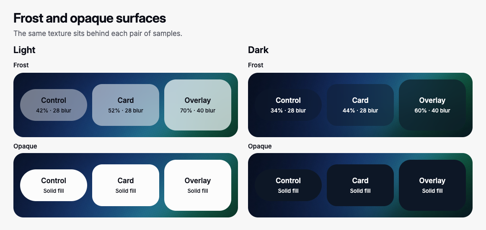

# Foundations

Kozu is the interface system for Kozu Group. Accounts, Tasks and Activity share materials, type roles, controls and state behavior. Accounts prioritizes balances and transactions. Tasks prioritizes listening, review and work in progress. Activity prioritizes events, evidence and outcomes.

## Design and implementation contract

Use the materials and typography page in the [editable kit](../Kozu%20Universal%20UI%20Kit.figcraft) to compose screens. Use [portable tokens](../Kozu.tokens.json) for cross-platform values, [component specifications](components.md) for component anatomy and [patterns](patterns.md) for complete flows. On the web, load [base styles](../web/kozu.css), [palette variables](../web/palette.css) and [component primitives](../web/components.css). Inspect behavior in the [interactive handbook](../web/guide.html).

Choose a semantic role before choosing a value. Bind the component to the role, then resolve the role by context and accessibility settings. For example, a primary button uses the action and on-action roles together. A resolved incident uses the recovery role on its icon and includes a visible status label. For a new token, document its role, supported modes, foreground and background pairs, accessible fallback and platform mappings.

Kozu measurements use logical units. Implement spacing and targets with CSS pixels on the web, points on Apple platforms and density-independent pixels on Android. Use relative type on the web, platform text scaling for Apple custom fonts and `sp` for Android text. Use host metrics for system chrome. [Apple HIG typography](https://developer.apple.com/design/human-interface-guidelines/typography) · [Android font scaling](https://developer.android.com/about/versions/14/features#non-linear-font-scaling)

## Color and materials

The six hue ramps are **Orange, Green, Blue, Gold, Violet and Rose**. **Graphite** is the neutral ramp. Every ramp exposes 11 steps, `50`, `100`, `200`, `300`, `400`, `500`, `600`, `700`, `800`, `900` and `950`, with shared aliases across adapters. Match adapters by ramp, step and semantic alias. Use the exported values as the palette authority. [Web palette](../web/palette.css) · [Apple color assets](../platforms/apple/KozuColors.xcassets) · [Android color resources](../platforms/android/res/values/kozu_colors.xml)

| Role | Kozu use |
| --- | --- |
| General action | Use Blue through the action and on-action aliases for primary controls. Measure the pair in both appearances. |
| Attention | Use the Orange notice alias for alerts and attention states. The telemetry seed is `#FF9765`. Pair it with a status word and glyph. |
| Recovery | Use the Green success alias for confirmed recovery or completion. The telemetry seed is `#A7D5A4`. |
| Information | Use the Blue info alias for informational and investigation events. The telemetry seed is `#ABC1FF`. Give information and actions distinct treatment through shape and placement. |
| Comparative data | Reserve Gold, Violet and Rose for comparing series. Add labels, markers or line styles and keep each series identifiable across ranges and filters. |
| Neutral | Use Graphite and the defined surface pairs for canvas, raised surfaces, controls, text and secondary content. Keep secondary text readable in context. |

On the web, apply `--kz-action` with `--kz-on-action`. The same aliases map to `KzAction` and `KzOnAction` in Apple color assets, and `@color/kz_action` and `@color/kz_on_action` on Android. Use the focus alias independently of selection and use chart aliases for labeled series.

Use blue-to-jade fields to connect destinations visually. Use Paper for white reading surfaces and forms. Use Ink for dark navy workspaces and telemetry. Keep fields static. Use grain and texture behind content at a strength that preserves labels and data marks. Blue and jade can recur on the page while response states keep their semantic color assignments.

- Use surface fill, opacity, spacing and type weight to separate surfaces. Use borderless component shells. Preserve icon strokes, chart marks, selection checks, functional separators and native focus treatments.
- Use host materials for system chrome. Apple describes how its materials respond to accessibility settings, including reduced transparency and increased contrast. [Apple HIG materials](https://developer.apple.com/design/human-interface-guidelines/materials)

### Frost and opaque surfaces

Apply the fill directly to the surface. Keep text, glyphs and focus treatments at their intended opacity. On native Kozu surfaces, tint light frost with `#FCFCFC` and dark frost with `#0D1726`. On the web, resolve the fill through the corresponding palette variable.

| Surface | Web fill | Light fill opacity | Dark fill opacity | Backdrop blur |
| --- | --- | --- | --- | --- |
| Control | `--kz-frost-control` | 42% | 34% | 28 units |
| Card or toolbar | `--kz-frost-card` | 52% | 44% | 28 units |
| Overlay | `--kz-frost-overlay` | 70% | 60% | 40 units |

These values are Kozu starting points. Keep texture and light visible through glass. Compare the surface over the brightest, darkest and most detailed crop in its reachable backdrop. Check default and secondary text, icons and the focused state. If a crop fails contrast, adjust the text or local tint and measure again. Use a solid surface when the backdrop cannot support the content or the host cannot render blur smoothly.

Keep opaque sheets available for dense reading and forms. For Reduce Transparency, replace frost with a solid fill and disable backdrop blur. Maintain the same hierarchy, accessible names and interaction states. [Apple HIG materials](https://developer.apple.com/design/human-interface-guidelines/materials)



### Contrast

Use at least **4.5:1** for ordinary text, **3:1** for large text that qualifies under WCAG and **3:1** for essential non-text graphics and visual information that identifies a control or its state. Measure against the actual adjacent color. For a moving viewport over a gradient, test the lowest contrast across the positions in which the item can appear. Where a material pair fails, change the foreground, add an opaque surface or use a stronger tint. [WCAG text contrast](https://www.w3.org/TR/WCAG22/#contrast-minimum) · [WCAG non-text contrast](https://www.w3.org/TR/WCAG22/#non-text-contrast) · [Apple Sufficient Contrast evaluation criteria](https://developer.apple.com/help/app-store-connect/manage-app-accessibility/sufficient-contrast-evaluation-criteria)

Use labels, geometry, glyphs or patterns to identify selection, error, progress and series membership. Verify focused and selected states independently, including when they appear together. Preserve accessible names, roles and state on every input method. [Apple HIG accessibility](https://developer.apple.com/design/human-interface-guidelines/accessibility) · [WCAG use of color](https://www.w3.org/TR/WCAG22/#use-of-color)

## Typography

| Role | Face | Application |
| --- | --- | --- |
| Prose and standard body | Inter, then system sans | Prefer 17 logical units at default size, with about 24 units of leading for prose. Use an elastic line height. |
| Controls and compact data | Inter, then system sans | Use the role size in the component spec. Keep labels readable at the narrowest layout and let them wrap or move to a stacked action layout. |
| Financial display | Inter | Enable tabular figures in aligned columns and changing balances. Keep the decimal and fractional amount legible on the same baseline. |
| Compact display and voice headings | Helvetica Neue, then Inter or system sans | Use for compact display hierarchy and voice headings. Check weight and wrapping after fallback. |
| Telemetry | Menlo, then platform monospace | Use for machine values such as timestamps, command fragments and identifiers. Use the prose role for explanations and recovery guidance. |
| Native chrome | Platform system face | Let the host style window controls, system toolbars and other native chrome. |

Use type by visual role across destinations. Scale the role through the host’s accessibility settings and maintain the hierarchy as text grows. Reflow adjacent content into a vertical layout before labels collide. Use a readable text measure for long descriptions and preserve the full content of wrapped commands and identifiers. Verify primary content and actions through at least **200%** text size, or **140% on watch** plus the native maximum where available. Apple publishes separate text size recommendations by platform. [Apple HIG typography](https://developer.apple.com/design/human-interface-guidelines/typography) · [Apple Larger Text evaluation criteria](https://developer.apple.com/help/app-store-connect/manage-app-accessibility/larger-text-evaluation-criteria) · [Font setup and licenses](../Fonts/README.md)

Use locale-aware dates, times, amounts, currencies, percentages and number signs. Give assistive technology a complete localized currency value once, even when the visual styling splits its parts. Align tabular amounts on the value edge in lists. Keep command text and machine identifiers in their intended reading direction within right-to-left layouts. [Apple HIG right to left](https://developer.apple.com/design/human-interface-guidelines/right-to-left)

## Geometry, density and icons

| Token or rule | Kozu value and use |
| --- | --- |
| Spacing scale | 4, 8, 12, 16, 20, 24, 32, 40, 48, 64. Use 4 within tightly coupled content, 8 between sibling controls, 16 for common insets and 24 or 32 for section separation. Choose a larger value when labels or host focus effects need space. |
| Sibling controls | Start with an 8-unit gap between hit regions. Keep regions distinct and prevent overlap at narrow widths and larger text sizes. |
| Regular touch | At least 48 × 48 logical units for Kozu controls. A smaller rendered glyph or chip can sit inside the hit region. |
| Compact pointer | At least 32 × 32 logical units for a deliberately dense pointer layout. Keep regular targets on shared touch surfaces and honor any larger host requirement or interaction need. |
| Shape | Use small, control, panel and sheet radius roles. The foundation values are 14, 24, 28 and 32. A capsule follows half its height. Derive an adjacent inner radius from `max(0, outerRadius - inset)` for symmetric insets. A 32-unit corner with an 8-unit inset gives a 24-unit inner corner. |
| Icons | Use Lucide on a 24-unit source grid with a 1.8-unit source stroke. Match visible icon height to label cap height in a text button. Center the ink in its slot and use balanced slots to center the label within the full button. |

Measure targets and gaps on actual hit regions. Center grouped controls, align their optical weight and keep space for a visible focus treatment. Let native Apple layouts respect safe areas, layout margins and host rounding. SwiftUI offers container-relative corners for supported hosts. The table contains Kozu measurements. [Apple HIG layout](https://developer.apple.com/design/human-interface-guidelines/layout) · [Apple SwiftUI ConcentricRectangle](https://developer.apple.com/documentation/swiftui/concentricrectangle) · [Lucide license](../Icons/LICENSE.txt)

### Dot matrices

Use 4-unit circles on an 8-unit center-to-center pitch on both axes. The pitch and diameter stay fixed as the track changes size. Add or remove whole columns and center the resulting matrix with equal unused horizontal margins.

Let `width` be the space available to the matrix after the surrounding labels, controls and padding. The column count is `0` when `width < 4`. Otherwise it is `1 + floor((width - 4) / 8)`. With at least one column, the matrix occupies `4 + 8 × (columns - 1)` units. Split the leftover width equally at the two edges. For example, a 15-unit track fits two columns with 1.5 units of margin on each side.

The editable FigCraft tracks respond to width changes in the editor. Each ships with 256 columns, enough for a 2,044-unit matrix. PDF page 43 shows a progress track at three widths. Page 45 shows listening and Reduce Motion. For a custom FigCraft percentage or a larger matrix, use the [dot-grid authoring tool](../tools/reflow_dot_grids.py). Web, SwiftUI and Compose calculate the count directly from the available width.

To edit a copy of the kit, list the grid and owner IDs, then pass the owner ID and desired control width to `resize`. For example, the progress row on PDF page 23 can use a custom width and value.

```sh
python3 -B tools/reflow_dot_grids.py list "Kozu Universal UI Kit.figcraft"
python3 -B tools/reflow_dot_grids.py resize "Kozu Universal UI Kit.figcraft" 2754 430 --percent 67 -o "Custom progress.figcraft"
```

| Matrix | Rows |
| --- | --- |
| Determinate progress | 2 |
| Compact activity | 3 |
| Wide peak waveform | Up to 7 |

Quantize data into whole lit or unlit dots. Keep circles whole at every width and value.

For determinate progress, light `floor(totalVisibleDots * percent / 100)` dots. Include every visible dot in the matrix count, including any extra dim dots at the trailing edge of a static specimen. Fill columns from leading to trailing. Within each column, light the top dot, then the bottom dot, before advancing. At **0%** all dots are dim. At **100%** all visible dots are lit.

The following left-to-right example has ten visible dots. At 56%, five are lit across the first two complete columns and the top dot of the third.

| Progress | Top row | Bottom row |
| --- | --- | --- |
| 0% | ○ ○ ○ ○ ○ | ○ ○ ○ ○ ○ |
| 56% | ● ● ● ○ ○ | ● ● ○ ○ ○ |
| 100% | ● ● ● ● ● | ● ● ● ● ● |

Show the exact percentage next to the matrix and expose it programmatically as the progress value. Keep the value or named status available when the track fits zero columns.

## Interaction and motion

- Give every interactive control a default, focused, pressed and disabled treatment. Add selected, hovered or pending when the control supports that state. Focus shows the current input location. Selection expresses the current value or destination. A selected control still needs a distinct focus treatment.
- Respond to input promptly. Animate a state change only where movement clarifies cause, spatial continuity or active work. Keep background materials still. End transient motion when the action ends and stop any listening animation when listening stops.
- Under Reduce Motion, keep state changes and progress readable with static marks or a simple opacity change. The listening indicator has a steady waveform with a visible **Listening** label and **Stop** action. Determinate work retains an exact numeric value. Preserve the same reading order, focus and available controls across motion settings. [Apple HIG motion](https://developer.apple.com/design/human-interface-guidelines/motion) · [Apple Reduced Motion evaluation criteria](https://developer.apple.com/help/app-store-connect/manage-app-accessibility/reduced-motion-evaluation-criteria)
- Use short sentence-case labels with a verb for actions, a noun for destinations and a word for status. Place labels alongside the data or control they explain. Give icon-only controls a localized accessible name. Write errors with the effect and the next action. [Apple HIG writing](https://developer.apple.com/design/human-interface-guidelines/writing)

## Change review

1. Start from an existing role and component. Specify what changes for input, state, viewport, contrast, scale and motion.
2. Update the editable specimen, portable token contract and applicable adapters together. Record meaningful token or component changes so existing consumers can migrate.
3. Exercise normal, loading, empty and error states in a real flow. Check focus, screen-reader output, contrast over materials, text scaling, long labels and target spacing.
4. Review the implementation and evidence using the [platform release checks](platforms.md#release-verification). Verify the new behavior at its normal entry point.
